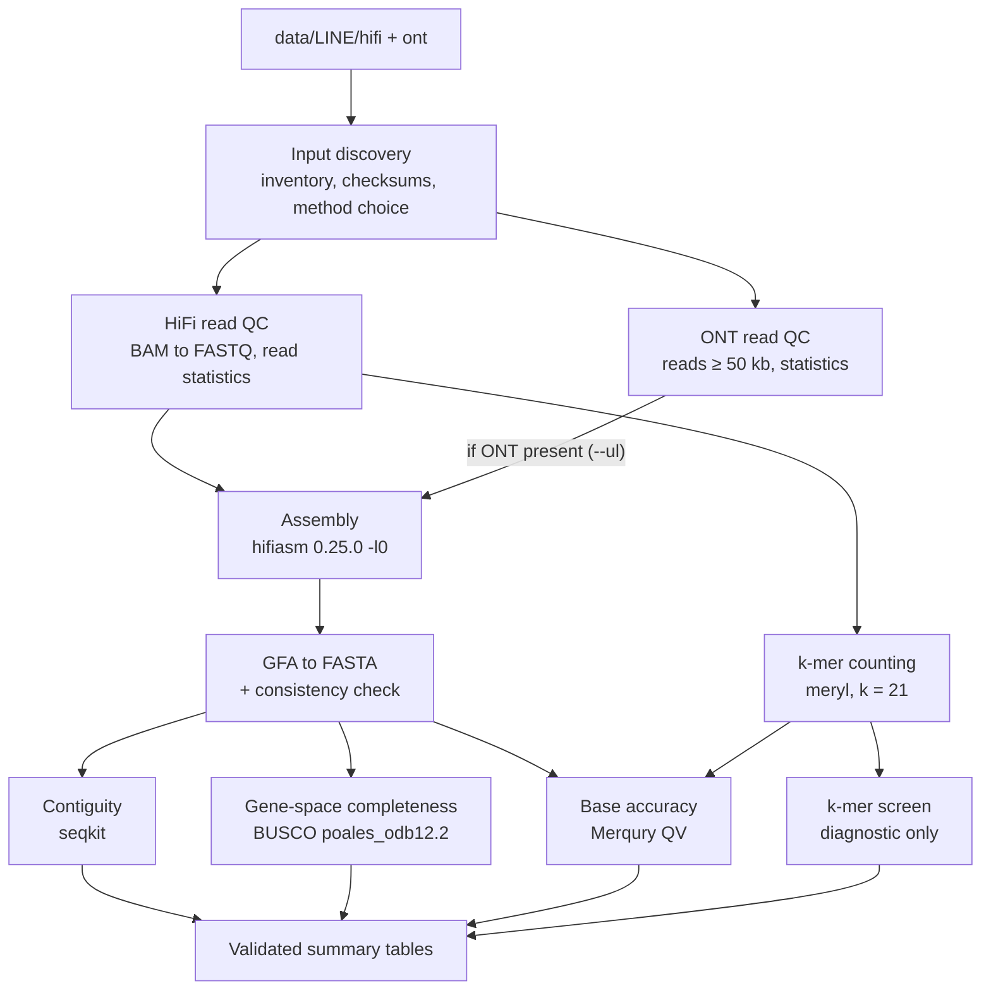

# G2F 2024 maize genome assemblies

A reproducible Snakemake pipeline that turns PacBio HiFi reads (plus Oxford
Nanopore reads, where available) into validated hifiasm genome assemblies
and publication-ready QC tables. It is being used for nine Genomes to Fields
(G2F) maize inbred lines: 3AZA1, FBLL, GEMS-0061, GEMS-0113, GEMS-0219,
GEMS-0227, PHB47, PHBW8 and PHP02.

* Every line goes through the same versioned methods: hifiasm v0.25.0 with
  no haplotig purging (`-l0`), with ONT reads added as ultra-long reads when
  present.
* Every result records the inputs, parameters, tool versions and commands
  that produced it.
* PHBW8 is the first validation line.

The pipeline does not need an AI agent to run. Annotation (EDTA, GeneCAD,
PlantCAD) and pangenome analyses are planned but **not yet implemented**;
see [docs/planned_extensions.md](docs/planned_extensions.md).

## Contents

[Installation](#installation) · [Inputs](#inputs) ·
[Running the pipeline](#running-the-pipeline) · [Workflow](#workflow) ·
[Outputs](#outputs) · [Reproducing and rerunning](#reproducing-and-rerunning) ·
[Documentation](#documentation)

## Installation

The pipeline is set up for Cornell BioHPC servers, where all tools are
already installed. On other systems, see "Other sites" below.

### 1. Lay out the project directory

The repository is cloned as `pipeline/` inside a project directory on local
`/workdir` storage. Reads and results live **next to** the repository,
never inside it:

```text
g2f_assemblies_2024/
├── pipeline/          # this repository
├── data/<LINE>/{hifi,ont}/   # input reads (never modified)
├── results/           # all outputs (created by the pipeline)
├── containers/        # pbtk container (step 3)
├── tmp/               # temporary files for jobs
└── hifiasm_v0.25.0/   # historical PHBW8 runs (cbsuxm01 only; read-only)
```

```bash
mkdir -p /workdir/$USER/g2f_assemblies_2024 && cd /workdir/$USER/g2f_assemblies_2024
git clone git@github.com:maize-genetics/g2f_2024.git pipeline
mkdir -p data results containers tmp
cd pipeline
```

### 2. Load Snakemake and create the local configuration

```bash
module load python/3.12.7      # provides Snakemake 9.26.1 and PyYAML
cp config/local/local.example.yaml config/local/local.yaml
```

Edit `config/local/local.yaml` and set `busco_lineage_dir` to where BUSCO
datasets are stored. This file is machine-specific and is not tracked by Git.

### 3. One-time downloads

**pbtk 3.5.0** is needed only for HiFi BAM input. It is not a BioHPC module,
so pull it pinned by digest (19 MB):

```bash
mkdir -p ../containers ../tmp/apptainer_cache
APPTAINER_CACHEDIR=$PWD/../tmp/apptainer_cache apptainer pull ../containers/pbtk-3.5.0.sif \
  docker://quay.io/biocontainers/pbtk@sha256:ab2d8dcf1a80e2d7595ab8799c37037766db6fb35d6744440b4643f27749e0ab
```

**BUSCO lineage `poales_odb12.2`** (about 1 GB):

```bash
apptainer exec --bind /home/$USER/busco_downloads /programs/busco-6.1.0/busco.sif \
  busco --download_path /home/$USER/busco_downloads --download poales_odb12.2
cat /home/$USER/busco_downloads/lineages/poales_odb12.2/dataset.cfg   # compare with config/science.yaml
```

The pipeline checks the installed dataset against the release pinned in
`config/science.yaml` and refuses a different one.

### 4. Check the installation

```bash
bash tests/run_tests.sh          # synthetic data and stub tools; about 1.5 min
```

### Dependencies

| Tool | Version | On BioHPC |
|---|---|---|
| Snakemake | ≥ 8 (tested 9.26.1) | `module load python/3.12.7` |
| Python + PyYAML | 3.12 | same module |
| hifiasm | 0.25.0-r726 (checked at run time) | `/programs/hifiasm-0.25.0` |
| seqkit | 2.13.0 | `/programs/seqkit-2.13.0` |
| samtools | 1.20 | `/programs/samtools-1.20` |
| pbtk (`bam2fastq`, `pbindex`) | 3.5.0 | container, step 3 |
| meryl + Merqury | Merqury 1.3 | `/programs/merqury-1.3/merqury.sif` |
| BUSCO | 6.1.0 (checked at run time) | `/programs/busco-6.1.0/busco.sif` |
| Apptainer | any recent | installed |

**Other sites.** Tool locations are kept in `config/tools/biohpc.yaml`.
Copy it, change the paths, and point `tools:` in `config/config.yaml` at
the copy. Scientific settings do not change.

## Inputs

Put each line's reads in its own directory. **The directory name is the
line's ID.**

```text
data/
├── PHBW8/
│   ├── hifi/   EB2_PHBW8.hifi.fasta.gz
│   └── ont/    PHBW8_ONT_gt50kb.fastq.gz
├── PHB47/
│   ├── hifi/   (reads not yet added)
│   └── ont/
└── ...
```

* **`hifi/` (required):** PacBio HiFi reads, either unaligned `hifi_reads`
  BAM or FASTQ/FASTA (optionally gzipped). Several files (SMRT cells) are
  fine.
* **`ont/` (optional):** basecalled ONT FASTQ or BAM. If it has reads, the
  HiFi+ONT method is used; if it is empty or missing, the HiFi-only method
  is used. POD5/FAST5 must be basecalled first.
* **Empty line directories** are skipped, each with a `NO_INPUTS` warning,
  so a missing line is never mistaken for a processed one. Asking for such a
  line by name (below) is an error.
* **Line metadata and human decisions** (aliases, excluded files, reviewed
  warnings) are recorded in `config/samples.yaml`.

Review what the pipeline will use before running anything. This reads only
the first records of each file and takes seconds:

```bash
python3 scripts/g2f_tool.py discover
python3 scripts/g2f_tool.py discover --only PHBW8
```

The pipeline stops, with an explanation, on anything ambiguous: duplicated
data, non-HiFi PacBio reads, ONT files that look already filtered, malformed
files, or inputs that changed after results were built. See
[docs/reference.md](docs/reference.md#inputs).

## Running the pipeline

Run every command from `pipeline/` after `module load python/3.12.7`.
**Always dry-run first.** Long runs belong inside `screen`, so they survive
an SSH disconnect.

```bash
# Dry run: list every job and its exact shell command; runs nothing
snakemake --profile profiles/biohpc --dry-run --printshellcmds

# Read QC only: read preprocessing, read statistics, checksums, k-mer screen; no assembly
snakemake --profile profiles/biohpc --cores 32 reads_qc

# One line
snakemake --profile profiles/biohpc --cores 64 --config only_samples=PHBW8

# Several lines (comma-separated; each must have reads in data/)
snakemake --profile profiles/biohpc --cores 64 --config only_samples=PHBW8,PHB47

# Everything that has reads
screen -S g2f
snakemake --profile profiles/biohpc --cores 64

# QC of the registered historical PHBW8 assemblies only (read-only)
snakemake --profile profiles/biohpc --cores 32 imported_qc
```

* `only_samples` combines with any target, for example
  `reads_qc --config only_samples=PHBW8`.
* Naming a line without reads fails with `REQUESTED_SAMPLE_NO_INPUTS` and
  runs nothing.
* Re-running the same command resumes where it stopped. Finished work is
  never repeated.

### BioHPC execution profile

`profiles/biohpc/config.yaml` runs jobs directly on the server you are
logged into; it does not submit them to Slurm. It:

* sets `--cores 32` (override with `--cores`);
* re-runs jobs only when inputs are newer than outputs
  (`rerun-triggers: mtime`), so editing code or parameters never silently
  re-runs an assembly;
* keeps temporary files in `../tmp`, not the shared `/tmp`.

On a shared machine, set `--cores` to what you have reserved, and uncomment
`resources: mem_mb=...` in the profile to cap memory. A HiFi+ONT hifiasm
run of a maize line needs about 134 GB RAM, around 4 h at 100 threads, and
35–40 GB of disk. Per-step estimates are in
[docs/reference.md](docs/reference.md#expected-resources). Thread and memory
settings are in `config/resources/default.yaml` and never affect results.

## Workflow



| Stage | What it does | Why |
|---|---|---|
| Input discovery | Identifies every read file, detects duplicates and derived copies, records file identities and MD5s, and chooses the method (HiFi-only or HiFi+ONT) | Inputs are explicit, never double-counted, and cannot change silently under existing results |
| HiFi read QC | Converts BAMs with pbtk, and measures yield, length, quality and coverage | Confirms the reads are HiFi and sufficient before hours of assembly |
| ONT read QC | Keeps reads ≥ 50 kb for hifiasm `--ul` and reports what was kept | Only long reads improve contiguity; yields are reported, not assumed |
| k-mer counting and screen | Builds a meryl k-mer database and inspects the spectrum for unexpected heterozygosity | Confirms the line behaves as an inbred; the database is reused by Merqury |
| Assembly | hifiasm v0.25.0 with `-l0` (no haplotig purging), plus `--ul` when ONT reads exist | Purging can discard real sequence in homozygous inbreds |
| GFA to FASTA | Converts primary and alternate contigs, then checks every record against the GFA | Ensures the FASTA is exactly what hifiasm produced |
| Contiguity | Contig count, N50, L50, GC, gaps; lists contigs < 1 Mb | Standard assembly statistics; small contigs are flagged for organelle and repeat follow-up |
| BUSCO | Completeness against the pinned `poales_odb12.2` dataset | Gene-space completeness. Duplication is not read as haplotig retention, because maize has an ancient genome duplication |
| Merqury | Consensus quality (QV) and k-mer completeness from the reads | Reference-free accuracy estimate |
| Summaries | Per-line and project tables built only from validated records | Every reported number is traceable |

The scientific reasoning behind each choice is in
[docs/scientific_decisions.md](docs/scientific_decisions.md).

## Outputs

Everything is written under `../results/`. The main paths for a line:

| What | Where |
|---|---|
| Assembly FASTA (write-protected) | `results/<LINE>/assembly/<method_id>/<LINE>.<method_id>.p_ctg.fa` (and `.a_ctg.fa`) |
| hifiasm outputs and logs | `results/<LINE>/assembly/<method_id>/` |
| Read QC | `results/<LINE>/reads/hifi/`, `results/<LINE>/reads/ont/` |
| k-mer database, histogram, screen | `results/<LINE>/kmer/` |
| QC reports (seqkit, BUSCO, Merqury) | `results/<LINE>/qc/<method_id>/` |
| Provenance (command, versions, inputs, host, time, Git commit) | `results/<LINE>/provenance/<step>/*.json` |
| Input inventory and checksums | `results/<LINE>/inputs/` |
| Per-line summary and completion marker | `results/<LINE>/summary/` |
| Project tables | `results/summary/assembly_summary.<VID>.<PID>.tsv` (workflow assemblies), `results/summary/imported_assemblies_summary.<VID>.<PID>.tsv` (historical assemblies, kept separate) |

* **Completion.** A line is finished only when its `*.validated.<VID>.<SID>.json`
  marker exists, which is written after every check passes. Output files
  existing is not enough.
* **Identity tags.** `VID` identifies the scientific configuration and
  validation code; `SID`/`PID` identify the recorded human decisions. Older
  tables are kept when either changes.
* **Full listing.** See
  [docs/reference.md](docs/reference.md#outputs-resultsline).

## Reproducing and rerunning

**Reproduce a previous analysis.**

1. Each provenance record holds the pipeline Git commit (and whether the
   working tree was clean), the exact command, tool versions and input
   identities. `results/.identity/validation-<VID>.json` lists the
   configuration a summary was validated under.
2. Check out that commit, keep the same `data/`, and rerun into a separate
   results directory so the original results are untouched:

   ```bash
   git checkout <commit>
   snakemake --profile profiles/biohpc --dry-run --config results_dir=/workdir/$USER/g2f_rerun only_samples=PHBW8
   ```

   Compare the new `inputs/inventory.json` and `inputs/md5/` with the
   original ones to confirm the same reads were used. The tool versions
   required by each method are checked when jobs run.

**Rerun a single QC component.** BUSCO, Merqury and contiguity statistics
can be regenerated, or extended (for example with an extra BUSCO lineage),
without repeating read QC or hifiasm. Previous results are kept. See
[docs/rerunning_qc.md](docs/rerunning_qc.md) for the commands, a guard that
prevents an accidental assembly, and current limitations. The main
limitation is that the BUSCO version is not yet part of the output path.

**Changing scientific parameters.** Assembly parameters live in immutable
files in `config/methods/`. To change them, create a new method file with a
new `method_id`; its results go to a separate directory. Editing a method
that has already been used is refused.

## Documentation

| Document | Contents |
|---|---|
| [docs/reference.md](docs/reference.md) | Input rules, resources, full output list, rerun and safety rules, error messages |
| [docs/rerunning_qc.md](docs/rerunning_qc.md) | Rerunning BUSCO, Merqury and statistics independently |
| [docs/scientific_decisions.md](docs/scientific_decisions.md) | Scientific choices and their justification |
| [docs/validation_status.md](docs/validation_status.md) | Which components are validated on real data |
| [docs/historical_assemblies.md](docs/historical_assemblies.md) | The manual PHBW8 assemblies that preceded the pipeline |
| [docs/qc_PHBW8_imported_2026-10-11.md](docs/qc_PHBW8_imported_2026-10-11.md) | First pipeline QC of the historical PHBW8 assembly |
| [docs/audit_2026-10-10.md](docs/audit_2026-10-10.md), [docs/realtools_validation_2026-10-11.md](docs/realtools_validation_2026-10-11.md) | Audit and tool-compatibility records |
| [docs/planned_extensions.md](docs/planned_extensions.md) | Planned annotation and pangenome modules |
| [AGENTS.md](AGENTS.md) | Project principles and rules for developers and AI assistants |

### Repository layout

```text
config/     science.yaml, methods/ (immutable), samples.yaml, resources/, tools/, local/ (untracked)
workflow/   Snakefile and rules/*.smk
scripts/    g2f_tool.py command-line helper and the g2f/ Python package
profiles/   Snakemake execution profile for BioHPC
tests/      unit, fixture, dry-run and stub end-to-end tests
docs/       documentation and decision records
```

Real-tool compatibility tests (real pbtk, hifiasm, meryl, Merqury and BUSCO
on tiny synthetic data, about 2–4 min):
`G2F_REALTOOLS=1 bash tests/run_tests.sh test_realtools`.
