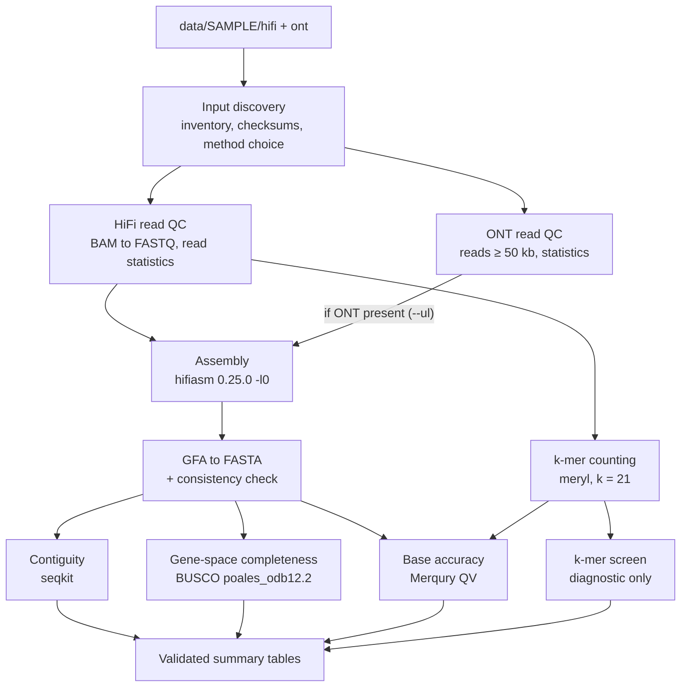

# Genome assembly and QC pipeline (hifiasm, HiFi + ultra-long ONT)

A reproducible Snakemake pipeline that turns PacBio HiFi reads (plus Oxford
Nanopore reads, where available) into validated hifiasm genome assemblies
and publication-ready QC tables. It was developed for inbred maize lines of
the Genomes to Fields (G2F) initiative, but sample names, input and output
directories, resources, tools and the execution environment are all
configurable.

* Every sample goes through the same versioned methods: hifiasm v0.25.0
  with no haplotig purging (`-l0`), with ONT reads added as ultra-long reads
  when present.
* Every result records the inputs, parameters, tool versions and commands
  that produced it.
* Nothing is deleted unless you opt in, and raw data are never modified.

The pipeline does not need an AI agent to run. Annotation (EDTA, GeneCAD,
PlantCAD) and pangenome analyses are planned but **not yet implemented**;
see [docs/planned_extensions.md](docs/planned_extensions.md).

## Contents

[Installation](#installation) · [Inputs](#inputs) ·
[Running the pipeline](#running-the-pipeline) · [Workflow](#workflow) ·
[Outputs](#outputs) · [Reproducing and rerunning](#reproducing-and-rerunning) ·
[Documentation](#documentation)

## Installation

### 1. Lay out the project directory

Clone the repository as `pipeline/` inside a project directory on fast local
storage. Reads and results live **next to** the repository, never inside it
(both locations are configurable):

```text
my_project/
├── pipeline/                   # this repository
├── data/<SAMPLE>/{hifi,ont}/   # input reads (never modified)
├── results/                    # all outputs (created by the pipeline)
├── logs/                       # launcher logs (created by the launcher)
├── containers/                 # optional container images
└── tmp/                        # temporary files for jobs
```

```bash
mkdir -p /path/to/my_project && cd /path/to/my_project
git clone <repository URL> pipeline
mkdir -p data results tmp
cd pipeline
```

### 2. Install the tools

Any installation works as long as the commands are on `PATH` (the default,
`config/tools/default.yaml`) or listed in a tools file of your own. With
conda/mamba, for example (the versions the pipeline was tested with; check
that your channels provide them):

```bash
mamba create -n asm -c conda-forge -c bioconda \
  python=3.12 snakemake=9 pyyaml hifiasm=0.25.0 seqkit=2.13.0 samtools=1.20 \
  pbtk=3.5.0 merqury=1.3 busco=6.1.0 sourmash
mamba activate asm
```

| Tool | Version | Notes |
|---|---|---|
| Snakemake | ≥ 8 (tested 9.26.1) | with Python ≥ 3.11 (tested 3.12) and PyYAML |
| hifiasm | 0.25.0-r726 | checked at run time |
| seqkit | 2.13.0 | |
| samtools | 1.20 | |
| pbtk (`bam2fastq`, `pbindex`) | 3.5.0 | only for HiFi BAM input |
| meryl + Merqury | Merqury 1.3 | set `MERQURY` to the install directory if your installation does not |
| BUSCO | 6.1.0 | checked at run time |
| sourmash | 4.x | only for optional fingerprinting |
| GNU parallel, `taskset` | any | only for `scripts/run_all_assemblies.sh` (Linux) |

**Sites with fixed install paths or containers.** Copy
`config/tools/default.yaml`, change the commands, and select the copy with
`tools:` in your project configuration (step 3).
`config/tools/biohpc.yaml` is a worked example for Cornell BioHPC servers
(public `/programs` installs and Apptainer images); there, pull the pbtk
image once, pinned by digest:

```bash
mkdir -p ../containers ../tmp/apptainer_cache
APPTAINER_CACHEDIR=$PWD/../tmp/apptainer_cache apptainer pull ../containers/pbtk-3.5.0.sif \
  docker://quay.io/biocontainers/pbtk@sha256:ab2d8dcf1a80e2d7595ab8799c37037766db6fb35d6744440b4643f27749e0ab
```

### 3. Configure the project and the machine

```bash
cp config/local/local.example.yaml config/local/local.yaml   # BUSCO datasets, external inputs
cp config/config.yaml config/local/config.yaml               # optional: project settings
```

* `config/local/local.yaml`: set `busco_lineage_dir`.
* `config/local/config.yaml` (optional): if present, it replaces
  `config/config.yaml` (as does a file named by `$PIPELINE_CONFIG`). Set
  data and results directories, the tools file, the resources file, and the
  launcher defaults here.
* `config/samples.yaml` (optional): per-sample human decisions; start from
  `config/samples.example.yaml`.

Everything in `config/local/`, `config/samples.yaml` and
`config/external_assemblies.yaml` is untracked; see
[config/local/README.md](config/local/README.md).

### 4. Download the BUSCO lineage

**`poales_odb12.2`** (about 1 GB; choose a lineage for your species in
`config/science.yaml`):

```bash
busco --download_path /path/to/busco_downloads --download poales_odb12.2
cat /path/to/busco_downloads/lineages/poales_odb12.2/dataset.cfg   # compare with config/science.yaml
```

The pipeline checks the installed dataset against the release pinned in
`config/science.yaml` and refuses a different one.

### 5. Check the installation

```bash
bash tests/run_tests.sh          # synthetic data and stub tools; a few minutes
```

## Inputs

Put each sample's reads in its own directory. **The directory name is the
sample ID** (letters, digits, `_`, `.`, `-`).

```text
data/
├── SAMPLE_A/
│   ├── hifi/   movie1.hifi_reads.bam  movie2.hifi_reads.bam
│   └── ont/    run1_fastq.tar  run2.fastq.gz
├── SAMPLE_B/
│   └── hifi/   SAMPLE_B.hifi.fastq.gz
└── ...
```

* **`hifi/` (required):** PacBio HiFi reads, either unaligned `hifi_reads`
  BAM or FASTQ/FASTA (optionally gzipped). Several files (SMRT cells) are
  fine.
* **`ont/` (optional):** basecalled ONT FASTQ or BAM, or a facility tar
  archive of MinKNOW FASTQ (`*_fastq.tar` with `fastq_pass/*.fastq.gz`). Tar
  archives are read in place and never extracted: `fastq_pass` members are
  streamed in order, and `fastq_fail` members are excluded. If `ont/` has
  reads, the HiFi+ONT method is used; if it is empty or missing, the
  HiFi-only method is used. POD5/FAST5 must be basecalled first.
* **Reads elsewhere** (another filesystem) can be referenced read-only from
  `config/local/local.yaml` (`external_inputs`).
* **Empty sample directories** are skipped, each with a `NO_INPUTS`
  warning, so a missing sample is never mistaken for a processed one. Asking
  for such a sample by name (below) is an error.
* **Sample metadata and human decisions** (aliases, excluded files, reviewed
  warnings) go in the optional `config/samples.yaml`.

Review what the pipeline will use before running anything. This reads only
the first records of each file and takes seconds:

```bash
python3 scripts/g2f_tool.py discover
python3 scripts/g2f_tool.py discover --only SAMPLE_A
python3 scripts/g2f_tool.py discover --config config/local/config.yaml   # with a project configuration
```

The pipeline stops, with an explanation, on anything ambiguous: duplicated
data, non-HiFi PacBio reads, ONT files that look already filtered, malformed
files, or inputs that changed after results were built. See
[docs/reference.md](docs/reference.md#inputs).

## Running the pipeline

Run every command from `pipeline/`. **Always dry-run first.** Start long
runs in a detached `screen` (or `tmux`) session that runs only the job and
closes when it ends, so the run survives a disconnect without leaving an
idle shell behind; the log and exit-status files keep the result
([docs/reference.md](docs/reference.md#running-all-samples)).

```bash
# Dry run: list every job and its exact shell command; runs nothing
snakemake --profile profiles/local --dry-run --printshellcmds

# Read QC only: read preprocessing, read statistics, checksums, k-mer screen; no assembly
snakemake --profile profiles/local --cores 32 reads_qc

# One sample
snakemake --profile profiles/local --cores 64 --config only_samples=SAMPLE_A

# Several samples (comma-separated; each must have reads in data/)
snakemake --profile profiles/local --cores 64 --config only_samples=SAMPLE_A,SAMPLE_B

# Everything that has reads
snakemake --profile profiles/local --cores 64

# QC of registered previous assemblies only (read-only; config/external_assemblies.yaml)
snakemake --profile profiles/local --cores 32 imported_qc

# Optional genotype fingerprinting: is each ONT read set the genotype it is
# labelled as? (k-mer QC against all HiFi genotypes; no assembly)
snakemake fingerprint --profile profiles/local --cores 32
```

* `only_samples` combines with any target, for example
  `reads_qc --config only_samples=SAMPLE_A`.
* Naming a sample without reads fails with `REQUESTED_SAMPLE_NO_INPUTS` and
  runs nothing.
* Re-running the same command resumes where it stopped. Finished work is
  never repeated.

### All samples at full scale

`scripts/run_all_assemblies.sh` runs every sample through the workflow, one
Snakemake process per sample, **one sample at a time** by default
(`--jobs N` runs N at a time). The next sample starts only after the
previous one completed; by default the first sample that does not complete
ends the queue (`--on-failure continue` carries on). It checks tools, disk
and memory first, keeps per-sample logs in `../logs/`, and resumes when
rerun: samples left running by a crash are marked `interrupted`, completed
work is skipped.

Its defaults (samples at a time, threads, memory, disk reserve, resources
file, Snakemake profile) come from the `launcher:` section of the top-level
configuration, and command-line options override them. For a large node,
see `config/resources/large_node.yaml`.

```bash
bash scripts/run_all_assemblies.sh --dry-run        # preflight + per-sample dry run
S=$(date +%Y%m%d_%H%M%S)                           # detached; the session ends with the run
screen -dmS g2f_run bash -c "set -o pipefail; bash scripts/run_all_assemblies.sh 2>&1 | tee ../logs/launcher.$S.out; echo \$? > ../logs/launcher.$S.exit"
bash scripts/run_status.sh                          # state of every sample, disk, CPU, memory
```

Never more than `--jobs` samples run: GNU parallel, a hard limit in the
disk gate, and a project-wide lock (`logs/launcher.lock`; a second launcher
is refused, and so is a launch while a Snakemake/hifiasm process of yours
works in this pipeline or results directory). The thread limit is enforced:
each running sample is pinned (`taskset`) to its own block of `--threads`
CPUs, one per physical core before any hyperthread, so the run never uses
more than jobs × threads CPUs, and the launcher refuses to start if that
many are not available. When running Snakemake directly, `--cores` alone is
not a hard limit; see `profiles/local/config.yaml`.

A disk gate starts a sample only when its projected peak fits. hifiasm runs
only after its prepared inputs pass verification. With a raw-data manifest
and a remote-copy table configured, the launcher also reports which local
raw BAM/tar copies are safe to delete by hand
(`python3 scripts/g2f_tool.py raw-release`; the pipeline never deletes raw
data). Monitoring, stopping, resuming after a crash and reusing hifiasm
checkpoints are described in
[docs/reference.md](docs/reference.md#running-all-samples).

**Nothing is deleted unless you opt in.** By default the workflow and the
launcher keep every read file and intermediate. Two deletions can be
switched on for disk space:

* `--retain-hifi auto|temp` (launcher) or `retain_prepared_hifi: false`
  (resources file): the converted HiFi FASTQ is deleted after hifiasm. The
  raw BAMs are then the only local copy, and `raw-release` never marks
  them eligible.
* `remove_hifiasm_bins_after_success: true` (resources file, e.g.
  `large_node.yaml`): hifiasm `.bin` files are deleted after a verified
  successful run. After an interruption they are hifiasm's checkpoints:
  reuse needs a written approval (`<SAMPLE>.asm.reuse_bins.approved`).

### Execution profiles

`profiles/local/config.yaml` (default) runs jobs directly on the machine
you are logged into; it does not submit them to a scheduler. It:

* sets `--cores 32` (override with `--cores`);
* re-runs jobs only when inputs are newer than outputs
  (`rerun-triggers: mtime`), so editing code or parameters never silently
  re-runs an assembly;
* keeps temporary files in `../tmp`, not the shared `/tmp`.

`profiles/biohpc/` is the same profile for Cornell BioHPC servers. On a
shared machine, set `--cores` to what you have reserved, and uncomment
`resources: mem_mb=...` in the profile to cap memory. A HiFi+ONT hifiasm
run of a ~2.3 Gb maize genome needs about 134 GB RAM, around 4 h at 100
threads, and 35–40 GB of disk. Per-step estimates are in
[docs/reference.md](docs/reference.md#expected-resources). Thread and memory
settings are in `config/resources/` and never affect results.

## Workflow



| Stage | What it does | Why |
|---|---|---|
| Input discovery | Identifies every read file, detects duplicates and derived copies, records file identities and MD5s, and chooses the method (HiFi-only or HiFi+ONT) | Inputs are explicit, never double-counted, and cannot change silently under existing results |
| HiFi read QC | Converts BAMs with pbtk, and measures yield, length, quality and coverage | Confirms the reads are HiFi and sufficient before hours of assembly |
| ONT read QC | Keeps reads ≥ 50 kb for hifiasm `--ul` and reports what was kept | Only long reads improve contiguity; yields are reported, not assumed |
| k-mer counting and screen | Builds a meryl k-mer database and inspects the spectrum for unexpected heterozygosity | Confirms the sample behaves as an inbred; the database is reused by Merqury |
| Assembly | hifiasm v0.25.0 with `-l0` (no haplotig purging), plus `--ul` when ONT reads exist | Purging can discard real sequence in homozygous inbreds |
| GFA to FASTA | Converts primary and alternate contigs, then checks every record against the GFA | Ensures the FASTA is exactly what hifiasm produced |
| Contiguity | Contig count, N50, L50, GC, gaps; lists contigs < 1 Mb | Standard assembly statistics; small contigs are flagged for organelle and repeat follow-up |
| BUSCO | Completeness against the pinned `poales_odb12.2` dataset | Gene-space completeness. Duplication is not read as haplotig retention, because maize has an ancient genome duplication |
| Merqury | Consensus quality (QV) and k-mer completeness from the reads | Reference-free accuracy estimate |
| Summaries | Per-sample and project tables built only from validated records | Every reported number is traceable |

The scientific settings and the reasoning for each are documented in the
comments of `config/science.yaml` and `config/methods/`.

## Outputs

Everything is written under the results directory (default `../results/`).
The main paths for a sample:

| What | Where |
|---|---|
| Assembly FASTA (write-protected) | `results/<SAMPLE>/assembly/<method_id>/<SAMPLE>.<method_id>.p_ctg.fa` (and `.a_ctg.fa`) |
| hifiasm outputs and logs | `results/<SAMPLE>/assembly/<method_id>/` |
| Read QC | `results/<SAMPLE>/reads/hifi/`, `results/<SAMPLE>/reads/ont/` |
| k-mer database, histogram, screen | `results/<SAMPLE>/kmer/` |
| QC reports (seqkit, BUSCO, Merqury) | `results/<SAMPLE>/qc/<method_id>/` |
| Provenance (command, versions, inputs, host, time, Git commit) | `results/<SAMPLE>/provenance/<step>/*.json` |
| Input inventory and checksums | `results/<SAMPLE>/inputs/` |
| Per-sample summary and completion marker | `results/<SAMPLE>/summary/` |
| Project tables | `results/summary/assembly_summary.<VID>.<PID>.tsv` (workflow assemblies), `results/summary/imported_assemblies_summary.<VID>.<PID>.tsv` (registered previous assemblies, kept separate) |

* **Completion.** A sample is finished only when its
  `*.validated.<VID>.<SID>.json` marker exists, which is written after every
  check passes. Output files existing is not enough.
* **Identity tags.** `VID` identifies the scientific configuration and
  validation code; `SID`/`PID` identify the recorded human decisions. Older
  tables are kept when either changes.
* **Full listing.** See
  [docs/reference.md](docs/reference.md#outputs-resultsline).

## Reproducing and rerunning

**Reproduce a previous analysis.**

1. Each provenance record holds the pipeline Git commit (and whether the
   working tree was clean), the exact command, tool versions and input
   identities. `results/.identity/validation-<VID>.json` lists the
   configuration a summary was validated under.
2. Check out that commit, keep the same `data/`, and rerun into a separate
   results directory so the original results are untouched:

   ```bash
   git checkout <commit>
   snakemake --profile profiles/local --dry-run --config results_dir=/path/to/rerun only_samples=SAMPLE_A
   ```

   Compare the new `inputs/inventory.json` and `inputs/md5/` with the
   original ones to confirm the same reads were used. The tool versions
   required by each method are checked when jobs run.

**Rerun a single QC component.** BUSCO, Merqury and contiguity statistics
can be regenerated, or extended (for example with an extra BUSCO lineage),
without repeating read QC or hifiasm. Previous results are kept. See
[docs/rerunning_qc.md](docs/rerunning_qc.md) for the commands, a guard that
prevents an accidental assembly, and current limitations. The main
limitation is that the BUSCO version is not yet part of the output path.

**Changing scientific parameters.** Assembly parameters live in immutable
files in `config/methods/`. To change them, create a new method file with a
new `method_id`; its results go to a separate directory. Editing a method
that has already been used is refused.

## Documentation

| Document | Contents |
|---|---|
| [docs/reference.md](docs/reference.md) | Input rules, resources, full output list, running all samples, rerun and safety rules, error messages |
| [docs/rerunning_qc.md](docs/rerunning_qc.md) | Rerunning BUSCO, Merqury and statistics independently |
| [docs/fingerprinting.md](docs/fingerprinting.md) | Optional k-mer genotype fingerprinting: method, calibration, outputs |
| [docs/planned_extensions.md](docs/planned_extensions.md) | Planned annotation and pangenome modules |
| [config/local/README.md](config/local/README.md) | Untracked project and machine configuration |
| [AGENTS.md](AGENTS.md) | Project principles, repository policy and rules for developers and AI assistants |

### Repository layout

```text
config/     config.yaml (portable defaults), science.yaml, methods/ (immutable),
            fingerprint*.yaml, resources/, tools/, *.example.yaml, local/ (untracked)
workflow/   Snakefile and rules/*.smk
scripts/    g2f_tool.py and g2f_fingerprint.py command-line helpers, the g2f/ Python package,
            run_all_assemblies.sh (full-scale launcher), run_status.sh
profiles/   Snakemake execution profiles (local = default; biohpc = optional)
tests/      unit, fixture, dry-run and stub end-to-end tests (synthetic data only)
docs/       user documentation
```

Real-tool compatibility tests (real pbtk, hifiasm, meryl, Merqury and BUSCO
on tiny synthetic data, about 2–4 min; they use `config/tools/biohpc.yaml`):
`G2F_REALTOOLS=1 bash tests/run_tests.sh test_realtools`.

Research records of a particular project (run plans, QC reports, decisions)
are kept outside this repository; see [AGENTS.md](AGENTS.md).
